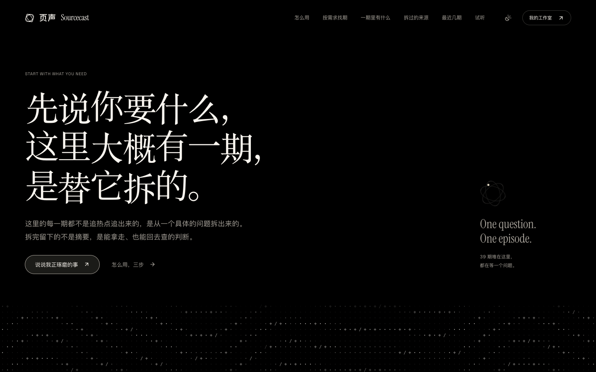
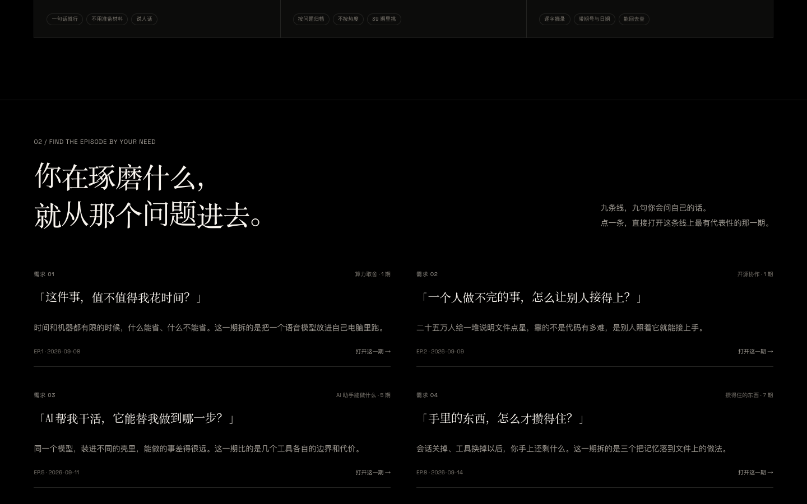
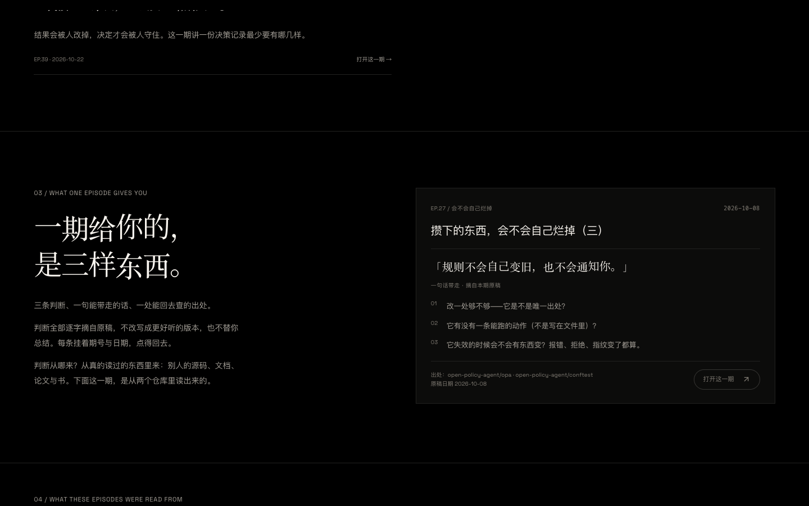
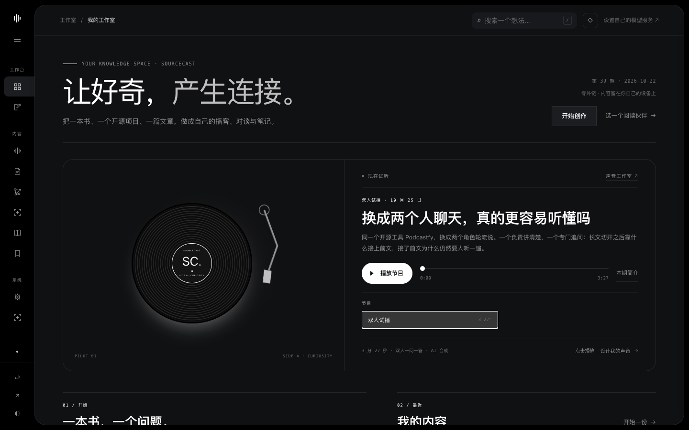

# github-podcast

**一个人用的 AI 播客流水线**：每天从 GitHub 抓高星 AI 开源项目，选一个，**逐文件读它的源码**，
写成中文口播稿，合成成音频，通勤路上听。

它不做「把新闻念一遍」的日报 bot。核心动作是**真的去读那个项目的源码**，然后讲给一个具体的人听。
所以它带验收闸（读没读源码、讲没讲透、有没有讲重）——不是为了好看，是没闸就一定会滑成摘要 bot。

线上站：**<https://wql18902-ux.github.io/sourcecast/>**
（「页声 Sourcecast」，源码就在本仓 `web/library/`）



## 目录

1. 这是什么
2. 页声 Sourcecast：一个能听的站
3. 快速开始
4. 定制化：改哪里就能变成你的
5. 验收闸：这个项目最该抄的部分
6. 合成路线
7. 目录导览
8. 踩过的坑（都会再现，别重新踩）
9. 双链写法
10. 已知限制
11. 致谢
12. License

---

## 这是什么

```
fetch.py ──► scripts/episode.py ──► 写稿会话 ──► verify-episode.sh ──► 合成 ──► 听
 抓高星项目      选料 + clone       读源码 + 写稿     四道闸           本地/云      云盘
 (SQLite)       (cache/)          (6500–10500 字)   (写 latest-status)
```

设计上分**两环**，交界是文件而不是函数调用：

| 环 | 在哪 | 干什么 | 成本 |
|---|---|---|---|
| 外环 | `agent/` + `scripts/*.sh` | 调度、闸门、降级、记账。纯确定性，可续跑 | 零模型调用 |
| 内环 | 你的 AI 会话（本仓 `skills/`） | 只在**写稿**和**审稿**两步烧 token | 每期一次 |

外环不调内环，它只往 `agent/request.json` 写任务书；会话干完写 `agent/done.json`，
外环跑 `python3 -m agent.cli resume` 接着走。**换宿主不重写**——`agent/` 只许标准库 + subprocess，
谁跑起来行为都一样。

## 页声 Sourcecast：一个能听的站

`web/library/` 是这条流水线的静态站（纯 HTML/CSS/JS，不需要服务端）。它是「讲给一个人听」的另一面：

> **你先说出自己的需求 → 从已经拆过的期次里找到对得上的那一期 → 看清它能为你提供什么帮助。**

期次按「你会遇到的问题」归档，不按项目火不火；每期的判断逐字摘自原稿，带期号与日期，点得回原稿。





**站点不接任何外部云、也不借别人的 API**：不填任何 Key 也能看完整站——39 期、50 条判断、
仓库与主题线、记忆网络、笔记、导图、双向链接、Markdown / SVG 导出、两段 AI 设计音色的试听都照常。
要生成自己的内容，只有两条路：

1. **在你自己的电脑上做**：导出任务书，交给自己的 AI 做完，再把正文导回创作台；
2. **接自己的模型服务**：自己填地址与 Key，Key 只在当前页面内存里，刷新即清空。



手机上也是同一套（390 宽，单列）：

<p></p>

本地跑：

```bash
cd web/library
python3 serve.py          # 开 http://127.0.0.1:3000/
```

这个脚本主要补 HTTP Range，音频进度条才拖得动；普通静态服务也能出声，但拖动会退化。

发布：`bash scripts/deploy_library.sh`。它把 `web/library/` 整目录同步到一个只放静态文件的公开仓，
推上去 GitHub Pages 就发布；脚本自带预检（引用齐全、无云 SDK）和线上自检（标题、关键 JS、音频 Range 206）。
介绍页源码在 `frontend/`，构建用 `node scripts/build_library_components.mjs`（需要 `frontend/` 下的 npm 依赖），
构建会顺手刷新 `index.html` 里 js/css 的 `?v=<sha 前 12 位>`。

> 本仓不带站点音频（媒体文件不进仓库）：想听，去线上站。

---

## 快速开始

```bash
# 1. 只需要 Python 3.9+ 标准库；要本地合成再装 VoxCPM2（见「合成路线」）
python3 -c "import sqlite3, urllib.request; print('依赖 OK')"

# 2. 填听众画像——这是整套定制化的入口，别跳过
cp config/audience.example.md config/audience.md
$EDITOR config/audience.md
#    这一份被 .gitignore 挡着，装的是你的私事，不会误提交

# 3. 手动跑通一期（不调任何模型，跑到选料就停）
PREP_ONLY=1 bash scripts/daily-prepare.sh
```

要完整一期（含写稿）需要一次 AI 会话，四步：

```bash
PREP_ONLY=1 bash scripts/daily-prepare.sh       # ① 抓料 + 选料 + clone，停在这
# ② 把 scripts/write-episode-prompt.md 全文喂给你的 agent，它会写 output/latest-script.md
bash scripts/verify-episode.sh                  # ③ 验收闸，写 output/latest-status.txt
bash scripts/pipeline.sh synth-local            # ④ 本地合成（不需要任何 API key）
```

`latest-status.txt` 首行必须是 `OK`，否则合成链路直接跳过——**它不会把昨天的稿子重录一遍**。
这个约定是整个系统里最重要的一条，所有下游都只认它。

---

## 定制化：改哪里就能变成你的

整条链路只有一个真正属于「你」的文件。

### ① `config/audience.md` —— 讲给谁听

`cp config/audience.example.md config/audience.md` 再填。选稿 prompt、写稿 prompt、审稿 prompt 里
每一次「落回听众的现实约束」，读的都是这一份。填不好它，出来的稿子就是写给所有人的，
也就是没写给任何人的。

必须写具体的：**跑得动什么 / 跑不动什么**（16G 内存？没独显？公司网封 GitHub？）、
**现在的主线是哪几件**（具体到能判断「这件事跟他有没有关」）、**类比只能从哪里取**、
**什么话题提到就跳过**。模板里带一份填好的示例人设，抄结构别抄内容。

### ② `fetch.py` 的 `QUERIES` —— 抓什么

三类分别对应听众的三条主线。换成自己的方向就改这一处，分类名会一路带到选稿和写稿链路。

### ③ `voices/` —— 用什么嗓子

仓库**不附任何参考音频**（那是作者本人的声音，公开它没意义）。放一段 10–20 秒干净人声到
`voices/podcast-voice.wav` + 同名 `.txt`（参考文本），就自动启用克隆模式，全期锁同一个音色。

> **参考文本是必需项，不是可选项**：只给音频不给文本，音色偏差 10.6%；给了文本，1.4%。

造音色一条命令：`bash scripts/voice_from_media.sh <音视频> <音色名> [起始秒] [时长秒]`。

### ④ `config/agent.json` —— 闸门判据、预算、合成路线

全部口径的唯一真相源。改行为改这里，不改代码。带 `_note` 的键是给人看的注释，代码不读。

---

## 验收闸：这个项目最该抄的部分

`scripts/verify-episode.sh` 是唯一入口，写 `output/latest-status.txt`。判据全是**能机械验的**：
「写得好不好」没法机械验，「有没有读源码」「够不够长」「有没有讲重」可以。

| 闸 | 判据 | 拦的是 |
|---|---|---|
| 稿子被更新 | `latest-script.md` mtime 变新 | agent 没写 / 写了没落盘 |
| 够时长 | 正文汉字 ≥8500（≈51 分钟） | 一路滑到 23 分钟、拆得太浅 |
| 密度跟得上 | 每 1000 汉字 ≥2 处具体的东西（文件名 / 参数 / 取舍点） | 「长而水」 |
| 过程走了 | breakdown ≥10 字段标题 + ≥8000 字节 + 含具体数字的行 ≥20 | **跳过读源码** |
| 防重复 | 本项目不在 `episodes.log` 出现过、不在黑名单里 | 重讲旧项目 |

> 试过用「稿子里出现多少文件名」当机械指标，四期真稿子**全过不了线**——口语稿天然说
> 「它的记忆模块」而不是 `memory.py`。量错了东西，已弃用。别再往这个方向加指标。

**密度才是真判据，字数只是代理指标**：短要解释，水要回炉。

---

## 合成路线

### 本地：VoxCPM2（默认，离线、不花钱）

自动流水线默认走本地 VoxCPM2 2B（GGUF Q8 + Metal），**不需要任何 API key、不花钱、离线可用**。

```bash
# 引擎目录：模型 + llama-tts-server 二进制（约几个 GB，自行准备）
export VOXCPM_TOOLS_DIR=~/research/local-tts/tools

bash scripts/pipeline.sh synth-local          # 整期
bash scripts/pipeline.sh tts-local 稿子.md    # 任意文本
```

16G 的 Mac 上实测整期能跑。产出侧**始终**挂 `-1.5 dBTP` 限幅（保险丝，不是除杂音的主力）；
句尾「滋」声用 `--denoise deesser` 治，A/B 对比入口 `bash scripts/ab-denoise.sh`。

### 云：MiMo（站点样音与试播用的是它）

```bash
bash scripts/pipeline.sh synth-mimo           # 整期（脚本：scripts/tts_mimo.py）
bash scripts/pipeline.sh tts-mimo 稿子.md     # 任意文本
```

参考音自备（同样不入库）。**站点上那两段试听样音和双人试播，都是 MiMo 生成的**，见下文「致谢」。

### 人工：云 TTS 控制台

`web/tts-console.html` + `scripts/tts_console.py`，跑 `bash scripts/run_tts_console.sh`
开在 `http://127.0.0.1:8787/`。**只做人工试听，不进自动流水线**。Key 只进 macOS Keychain
（服务名 `ai-jarvis-tts-console`），不落项目文件、不写日志、不回显到页面。

---

## 目录导览

```
fetch.py                     抓 GitHub 高星项目 → SQLite → output/<日期>.md（纯标准库）
scripts/
  episode.py                 选料 + clone 到 cache/
  daily-prepare.sh           每夜主编排：fetch → 选料 →（PREP_ONLY 停）→ 写稿 → 验收
  verify-episode.sh          验收闸唯一入口，写 latest-status.txt（下游只认这个）
  write-episode-prompt.md    写稿夜班任务书（流程 + 红线；深度规范在 skills/）
  write-research-prompt.md   调研稿链路（联网而非读源码，产物落 output/research/）
  check_prose.py             中文成稿质检：只报警不改文（破折号 / 冒号 / 黑话 / 翻案句）
  audience.py                读 config/audience.md，给各处 prompt 用
  tts_local.py               VoxCPM2 本地合成（克隆音色 + 限幅 + 可选降噪）
  tts_mimo.py                MiMo 云合成
  deploy_library.sh          把 web/library 发到 GitHub Pages
  build_library_components.mjs  构建介绍页 → web/library/vendor/lwq/components.js
agent/                       外环：调度 / 闸门 / 降级 / 记账。只用标准库 + subprocess
config/                      agent.json（口径真相源）/ tools.json / audience.md
skills/                      内环两份 SKILL.md：深度写稿规范 + agent 值守
web/library/                 页声 Sourcecast 站点（纯静态，线上站就是它）
frontend/                    介绍页源码（React + Vite，构建进 web/library/）
docs/                        架构设计、全流程梳理、双链写法、踩坑记录、站点截图
output/episodes/ep<N>-*/     成品期页（双链 [[ep<N>-<slug>]]）
cache/                       已 gitignore，2G+ 的源码缓存，随时可重建
```

---

## 踩过的坑（都会再现，别重新踩）

1. **死代理**：shell 里 `http_proxy` / `https_proxy` 指向 `127.0.0.1:7890`，代理进程常不在。
   联网命令报 `Connection refused` 时用
   `env -u http_proxy -u https_proxy -u HTTP_PROXY -u HTTPS_PROXY <命令>` 直连；
   git 另加 `-c http.proxy= -c https.proxy=`。脚本内部已自行绕过。
2. **`grep` 是 BSD 版、不认 `\|` 交替**：`grep "a\|b"` **静默零命中**，看着像「确实没有」，
   能把结论带偏。多关键词一律 `grep -E`。
3. **中文提示里变量名后紧跟全角字符一律加花括号**：`"… $VAR（…"` 会让 bash 把全角括号首字节
   吃进变量名，`set -u` 下直接崩。2026-09-21 修黑名单闸时这个 bug 和另一个互相掩盖了七天——
   `fail` 从来没被执行到。**改那段之后必须重跑正负样本。**
4. **拉大仓先比 tarball**：`git clone --filter=blob:none` 在超大仓上会卡在 fetch。
   先用 `curl -sL https://codeload.github.com/<owner>/<repo>/tar.gz/refs/heads/main` 比一次；
   **tarball 也会被中途截断**，截断就换 git；大仓直接走「先树后抓」：
   Trees API 拿全树 → 挑 6–10 个贴题文件用 `raw` 逐文件抓。`curl` 调 GitHub API 必须加
   `--http1.1`，否则 exit 16 静默失败。
5. **`fetch.py` 吞错**：GitHub 查询全失败仍退出码 0 且覆写当日 md。跑完必须检查输出有无
   `[!] 查询失败`，全失败则当日 md 不可信，须重跑。
6. **`rsync --delete` 会删掉目标仓的 `.git`**：往一个 git 仓里同步目录时，
   `--exclude='.git/'` 不是可选项——2026-09-24 和 2026-10-27 各踩过一次。

---

## 双链写法

纯文本 `[[...]]`，不搬家、不建库、不装插件。期次互指 `[[ep5-claude-code]]`，产品地图 `[[agent-map]]`，
笔记用文件名。用 Obsidian 打开本项目时自动成网；不用它也不影响任何脚本。每期 `page.md` 至少 2 条出链。
常驻地图 `agent-map.md` 是单一真相源：产品换代只改这一处，旧稿不动。

---

## 已知限制

- **没有实时兜底**：如果合成那一步失败，就没有第二班救它（`agent/launchd/` 里有兜底 plist，
  装之前先读同目录 README 的三条前提）。
- 写稿要一次 AI 会话。`agent/` 外环故意不内置模型调用——它只写任务书，等会话来干。
- 中文口径、GitHub 英文源。换语种要改 `write-episode-prompt.md` 的口径节和 `check_prose.py` 的词表。
- 站点的判断库是截至 2026-10-22 的 39 期快照；新一期写完要重跑
  `python3 scripts/build_library_data.py` 再发布。

---

## 致谢

- **MiMo（小米）** —— 站点上那两段试听样音（松弛男声 / 清透女声）和双人试播，都是用 MiMo 的
  语音合成做的；`scripts/tts_mimo.py` 这条云合成路线接的也是 MiMo。**MiMo (xiaomimic?的语音合成、
  音色设计与音色复刻目前是限时免费的**——所以这份东西的试听、试播不用自己贴钱就能跑起来。
  谢谢小米把这几项能力开放出来试用。收费规则、额度与模型可用性以官方开发平台实时口径为准
  （<https://platform.xiaomimimo.com/>）。
- **VoxCPM2 + llama.cpp** —— 本地合成路线（GGUF + Metal）让整条流水线能不花一分钱、离线跑完。
- **Podcastfy** —— 站点里「双人对谈」那个试播，思路参考了它的角色分工。
- **这 39 期拆过的开源项目**和它们的作者 —— 每一条判断都来自真的读过他们的代码、文档和提交记录。

---

## License

MIT。见 [LICENSE](LICENSE)。
